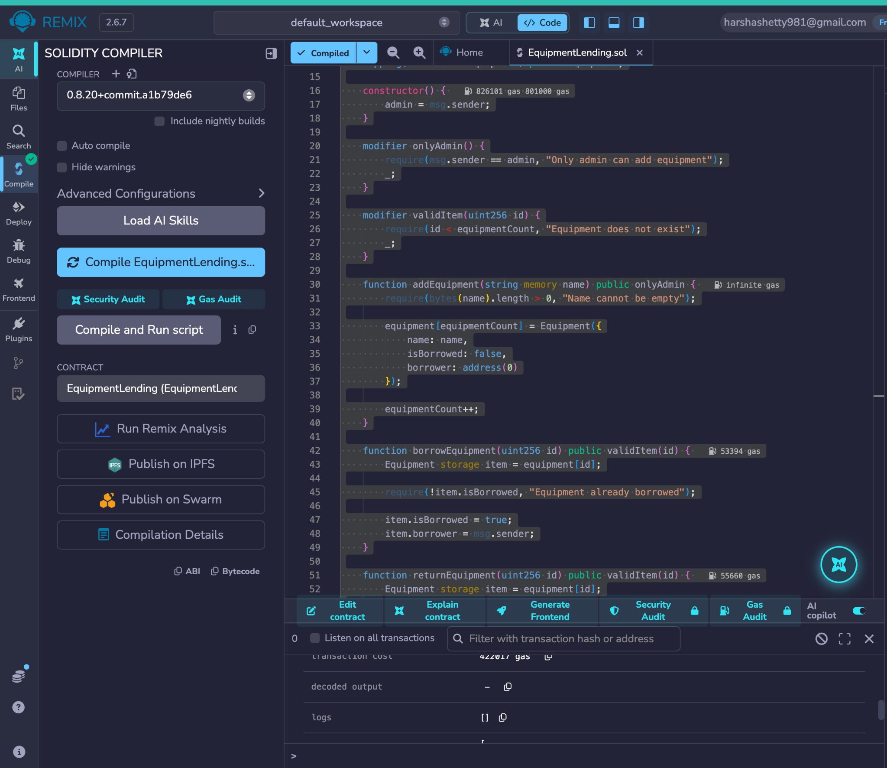
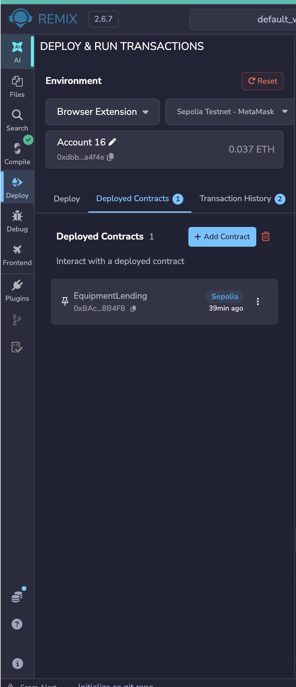
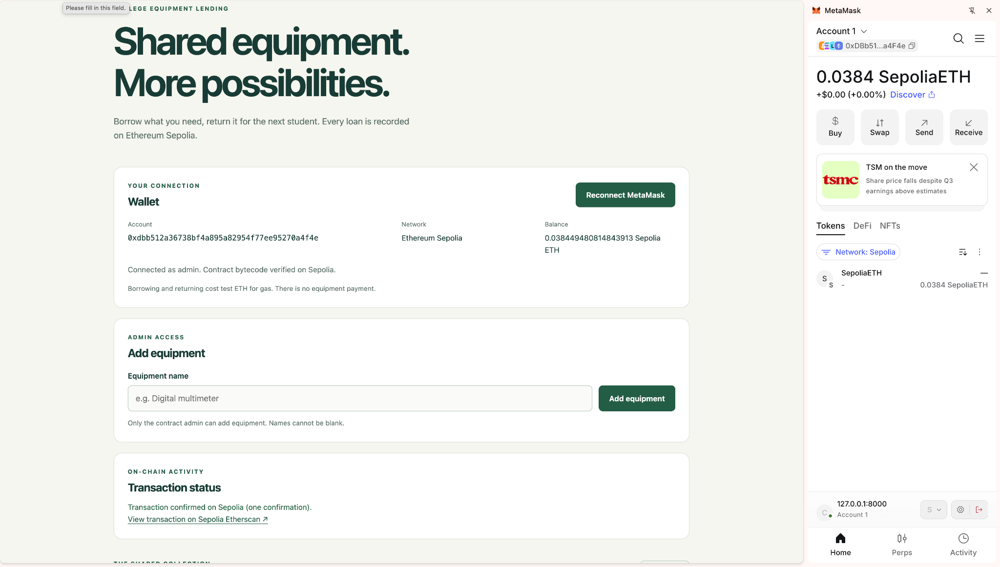
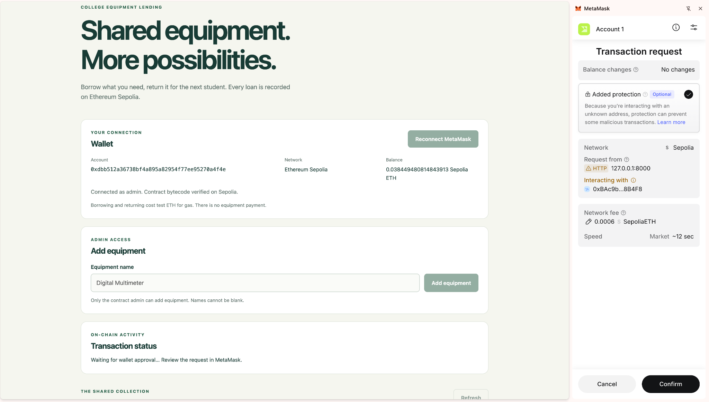
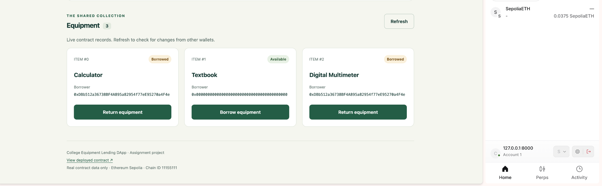
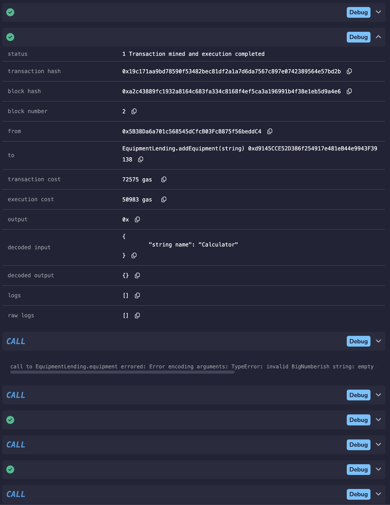
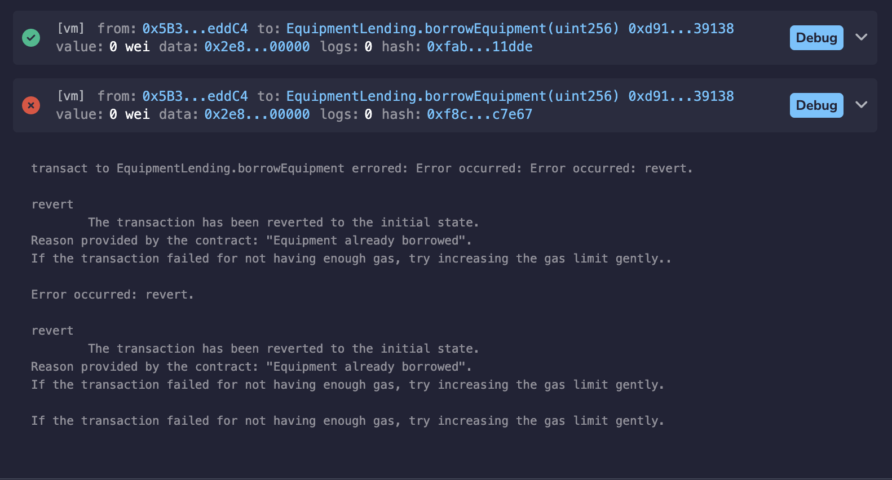
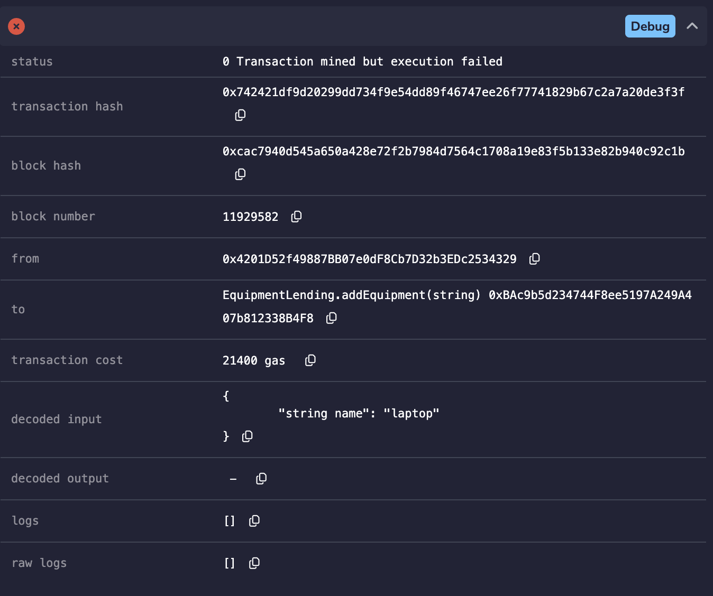

# College Equipment Lending DApp

| Student detail | Value |
| --- | --- |
| Name | Harsha Shetty |
| Registration number | 230905536 |
| Course | Blockchain Technology (CSE4444) |
| Assignment | Blockchain Assignment 2 |

## Problem Description

Shared college equipment can be difficult to manage when students and staff do not have a common record of item availability and current borrowers. This can lead to conflicting borrowing requests and uncertainty about who holds an item.

The College Equipment Lending DApp stores equipment records in a Solidity smart contract. Each item has an ID, name, availability state, and current borrower address. The admin registers equipment, users borrow available items, and only the recorded borrower can return an item. Borrowing records the user's wallet address; returning marks the item available and resets its borrower to the zero address. The browser interface retrieves these records from Ethereum Sepolia.

## Steps to Run the Application

### Prerequisites

- Python 3.
- A browser with the MetaMask extension installed and a configured wallet.
- Internet access to load Ethers.js from the CDN and connect to Ethereum Sepolia.
- Sepolia test ETH for transaction gas fees.

### Startup

1. Open a terminal in the project folder containing `index.html`, `app.js`, and `style.css`.
2. Start the local HTTP server:

   ```bash
   python3 -m http.server 8000
   ```

3. Open [http://127.0.0.1:8000](http://127.0.0.1:8000) in the browser with MetaMask.
4. Keep the server running while using the application. Press **Ctrl+C** in the terminal to stop it.

The frontend uses HTML, CSS, JavaScript, and Ethers.js. No package installation or build step is required. It is configured to use the existing Sepolia deployment listed below.

## MetaMask Connection and Contract Interaction

1. **Select Ethereum Sepolia:** Enable test networks in MetaMask if necessary and select Sepolia, chain ID `11155111`. If the application displays **Switch to Sepolia**, click it and approve the network switch.
2. **Obtain test ETH:** Request Sepolia test ETH from a Sepolia faucet using the wallet's public address. Test ETH covers gas fees for adding, borrowing, and returning equipment.
3. **Connect the wallet:** Click **Connect MetaMask**, select the account, and approve access. The application displays the connected account, network, and balance.
4. **View equipment:** Review the equipment IDs, names, availability, and borrower addresses loaded from the contract. Use **Refresh** to reload records.
5. **Add equipment as admin:** Connect the account that deployed the contract. In the admin form, enter a non-blank equipment name and click **Add equipment**. Approve the transaction in MetaMask and wait for confirmation.
6. **Borrow available equipment:** Click **Borrow equipment** on an available item. Approve the transaction in MetaMask and wait for confirmation. The contract records the connected account as the borrower.
7. **Return equipment as its borrower:** Connect the account recorded as the item's borrower and click **Return equipment**. Approve the transaction and wait for confirmation. The contract marks the item available and clears the borrower address.

## Deployment Details

| Detail | Value |
| --- | --- |
| Compilation and deployment tool | Remix IDE |
| Solidity compiler | 0.8.20 |
| Deployment network | Ethereum Sepolia |
| Chain ID | `11155111` |
| Contract address | `0xBAc9b5d234744F8ee5197A249A407b812338B4F8` |
| Explorer | [View contract on Sepolia Etherscan](https://sepolia.etherscan.io/address/0xBAc9b5d234744F8ee5197A249A407b812338B4F8) |

The contract source is [EquipmentLending.sol](contracts/EquipmentLending.sol). The deployment account is the contract admin. Remix VM was used for the local contract tests; the frontend connects to the Sepolia deployment.

## Test Cases and Observed Results

| Test case | Environment and input | Observed result | Evidence |
| --- | --- | --- | --- |
| Valid input: add equipment | Remix VM: admin calls `addEquipment("Calculator")` | Transaction succeeded with status `1`. | Figure 6 |
| Invalid input: borrow an already borrowed item | Remix VM: repeated `borrowEquipment` call for the same item | Rejected with the reason `Equipment already borrowed`. | Figure 7 |
| Unauthorised input: add equipment | Sepolia: a non-admin account calls `addEquipment("laptop")` | Transaction was mined but execution failed with status `0`. No readable revert reason is shown. | Figure 8 |
| Frontend retrieval | Sepolia: load equipment records | Names, IDs, availability, and borrower addresses were displayed for Calculator, Textbook, and Digital Multimeter. | Figure 5 |

## Screenshots

### Figure 1: Smart Contract Compilation — Remix IDE



EquipmentLending compiled with Solidity 0.8.20.

### Figure 2: Smart Contract Deployment — Sepolia



Remix displays EquipmentLending under deployed contracts on Sepolia.

### Figure 3: MetaMask Connection and Transaction Confirmation — Sepolia



The frontend displays the connected wallet and a Sepolia transaction confirmation with an explorer link.

### Figure 4: MetaMask Approval Request — Sepolia



MetaMask requests approval to add Digital Multimeter; the transaction is awaiting wallet approval.

### Figure 5: Blockchain Data in the Frontend — Sepolia



The frontend displays equipment IDs, names, availability, and borrower addresses. Digital Multimeter is recorded as borrowed.

### Figure 6: Successful Transaction — Remix VM



`addEquipment("Calculator")` completed with status `1` in Remix VM.

### Figure 7: Rejected Borrow Transaction — Remix VM



A repeated borrow attempt was rejected with `Equipment already borrowed`.

### Figure 8: Failed Non-Admin Transaction — Sepolia



The non-admin call to `addEquipment("laptop")` failed with status `0`; the receipt shows no readable revert reason.
